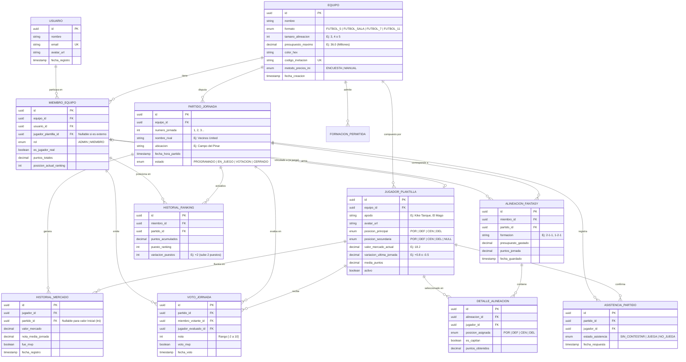

# Especificación de Software y Modelo de Datos: LigaMunicipalGuadaira

**LigaMunicipalGuadaira** es una aplicación web para moviles de *Fantasy Football* diseñada específicamente para equipos de ligas amateurs o municipales. A diferencia de los juegos de *fantasy* tradicionales basados en ligas profesionales, en Onzegol los usuarios crean una liga privada sobre **su propio equipo real**, alineando a sus compañeros cada jornada, confirmando asistencia a los partidos y puntuándose entre todos al finalizar cada encuentro.

---

## 1. Roles de Usuario

1. **Administrador del Equipo (Creador):** Usuario que crea el equipo en la plataforma, configura las reglas (formato, presupuesto, tamaño de alineación), gestiona el alta de la plantilla real, programa el calendario de partidos e invita al resto de participantes.
2. **Mánager Jugador:** Miembro que participa tanto en el juego *Fantasy* (creando alineaciones y votando) como en el terreno de juego real (forma parte de la plantilla, confirma asistencia y recibe valoraciones de sus compañeros).
3. **Mánager Externo:** Participante del *Fantasy* (entrenador, aficionado, amigo o lesionado de larga duración) que compite en el ranking armando sus alineaciones y votando después de los partidos, pero que **no** forma parte de la plantilla elegible en el campo.

---

## 2. Requisitos de Usuario (Historias de Usuario)

### Épica 1: Creación y Configuración del Equipo
* **RU-01 (Crear equipo):** Como *Administrador*, quiero crear un equipo indicando su nombre, color representativo, formato de juego (Fútbol 7) y si soy jugador activo o miembro externo, para adaptar automáticamente las reglas del *Fantasy*.
* **RU-02 (Gestión de plantilla):** Como *Administrador*, quiero dar de alta a los jugadores reales de mi equipo con su nombre/apodo, posición principal y posición secundaria opcional, para que estén disponibles en el mercado de alineaciones.
* **RU-03 (Fijación de precios iniciales):** Como *Administrador*, quiero definir los precios de mercado iniciales de cada jugador de forma manual o mediante una encuesta previa entre los miembros, para que el presupuesto inicial sea equilibrado y consensuado.
* **RU-04 (Gestión de calendario):** Como *Administrador*, quiero registrar los partidos de la temporada (rival, fecha, hora ) para habilitar las jornadas del *Fantasy*.

### Épica 2: Pre-partido y Gestión de Alineaciones (*Mi Equipo*)

* **RU-07 (Armado de alineación):** Como *Mánager*, quiero elegir una formación táctica permitida (ej. `2-3-1`) y seleccionar a los jugadores de mi equipo para cada puesto sin superar el presupuesto máximo (ej. $36\text{ M}$), para puntuar en la próxima jornada.
* **RU-08 (Consulta de estado al alinear):** Como *Mánager*, quiero ver en el selector de jugadores su precio actual, su media de puntos, su tendencia de valor de mercado y si han confirmado asistencia, así como recibir alertas visuales si tengo alineado a alguien que ha marcado que no juega.
* **RU-09 (Elección de capitán):** Como *Mánager*, quiero asignar la capitanía (`C`) a uno de los jugadores de mi alineación para que su puntuación tenga una bonificación especial en la jornada.

### Épica 3: Post-partido y Votaciones (*Jornada*)
* **RU-10 (Evaluación entre compañeros):** Como *Mánager*, quiero puntuar el rendimiento de cada compañero que disputó el partido en una escala de $-2$ a $10$, para determinar los puntos *Fantasy* de la jornada de forma democrática.
* **RU-11 (Votación de MVP):** Como *Mánager*, quiero marcar a un jugador como `MVP` del partido durante la votación para otorgarle un reconocimiento o bonificación extra.

### Épica 4: Mercado, Estadísticas y Clasificación (*Ranking* y *Jugadores*)
* **RU-12 (Fluctuación de precios):** Como *Mánager*, quiero que el valor de mercado de los jugadores suba o baje tras cada jornada en función de la nota obtenida, y poder visualizar su gráfica de evolución histórica ($J_1, J_2, \dots, J_n$).
* **RU-13 (Clasificación general):** Como *Mánager*, quiero consultar el ranking acumulado de la temporada y ver las subidas o bajadas de posición respecto a la jornada anterior para fomentar la competitividad en el grupo.

---

## 3. Requisitos Funcionales

### 3.1. Módulo de Administración y Onboarding
* **RF-01 (Parametrización por Formato):** Al seleccionar el formato del equipo, el sistema preconfigurará el tamaño de la alineación *Fantasy* recomendada (modificable posteriormente):
  * *Fútbol 7:* Alineaciones de $4$ jugadores.
* **RF-02 (Checklist de Puesta en Marcha):** El panel de administración mostrará el progreso de configuración inicial en $4$ pasos: 1) Añadir plantilla, 2) Invitar al equipo, 3) Poner precios iniciales y 4) Añadir calendario.
* **RF-03 (Encuesta de Precios Iniciales):** El sistema permitirá abrir una fase de encuesta donde los miembros proponen el valor inicial de cada jugador, calculando la media aritmética para fijar el precio de salida en millones ($\text{M}$).

### 3.2. Módulo de Jornada y Alineación (*Mi Equipo*)
* **RF-04 (Bloqueo por Cuenta Atrás):** El sistema mostrará una cuenta regresiva hasta la hora de inicio del próximo partido. Una vez alcanzado el tiempo límite ($t = 0$), se bloqueará la edición de alineaciones para esa jornada.
* **RF-05 (Validación de Presupuesto):** El sistema validará en tiempo real que la suma de los valores de mercado de los jugadores seleccionados no supere el presupuesto máximo del equipo ($P_{\text{máx}}$, ej. $36\text{ M}$):
  $$\sum_{i=1}^{k} V_i \le P_{\text{máx}}$$
  Si un jugador disponible cuesta más que el saldo restante ($P_{\text{restante}} = P_{\text{máx}} - \sum V_i$), el sistema deshabilitará su selección y mostrará la etiqueta `"Sin dinero"`.
* **RF-06 (Compatibilidad de Posiciones):** Al pulsar un hueco táctico en el césped (`POR`, `DEF`, `CEN`/`MED`, `DEL`), el sistema filtrará los jugadores cuya posición principal o secundaria coincida con la demarcación solicitada.

### 3.3. Módulo de Evaluación Post-Partido (*Jornada*)
* **RF-08 (Formulario de Votación):** Finalizado el encuentro, se habilitará la pantalla de evaluación con los jugadores convocados. Cada usuario podrá asignar una nota entera $N \in [-2, 10]$ por jugador y seleccionar un único `MVP` por partido.
* **RF-09 (Control de Progreso de Voto):** La interfaz mostrará el contador de jugadores valorados sobre el total (ej. `Votados 2/10`) antes de permitir el envío definitivo de las papeletas.
* **RF-10 (Cálculo de Nota Media y Puntos):** Al cerrarse el periodo de votación de la jornada $j$, la puntuación de cada jugador real $p$ se calculará a partir del promedio de los votos recibidos de los $m$ miembros votantes (más bonificaciones por MVP o reglas del equipo):
  $$\text{Media}_{p,j} = \frac{1}{m} \sum_{u=1}^{m} \text{Voto}_{u,p,j}$$
* **RF-11 (Cálculo de Puntuación del Mánager):** Los puntos obtenidos por un mánager en la jornada serán la suma de las puntuaciones finales de los jugadores de su alineación (aplicando el multiplicador correspondiente al jugador designado como Capitán).

### 3.4. Motor de Mercado y Clasificación (*Jugadores* y *Ranking*)
* **RF-12 (Algoritmo de Revalorización):** Tras el cierre de cada jornada, el sistema actualizará el valor de mercado de cada jugador ($\Delta V_{p,j}$) según la desviación de su nota respecto al rendimiento estándar de referencia (definido en la aplicación como $5\text{–}6$), registrando el nuevo valor en el historial para graficar la curva desde `Ini` hasta `Jn`.
* **RF-13 (Cálculo de Ranking y Diferencial de Puestos):** El sistema ordenará a todos los mánagers de mayor a menor puntuación total acumulada y calculará la variación de puestos respecto a la jornada $j-1$ (ej. $\blacktriangle 2$, `"DE 4º A 2º"`).

---

## 4. Diseño del Modelo de Datos

### 4.1. Diagrama Entidad-Relación (Mermaid)

---

### 4.2. Descripción de Tablas y Reglas de Integridad

1. **`EQUIPO` y `MIEMBRO_EQUIPO`:**
   * Soporta el requisito de que un usuario pueda pertenecer a varios equipos (p. ej., fútbol 7 los sábados y fútbol sala los miércoles) y que en un equipo pueda ser jugador de campo (`es_jugador_real = true`, apuntando a `jugador_plantilla_id`) o un participante externo (`es_jugador_real = false`, `jugador_plantilla_id = NULL`).
2. **`JUGADOR_PLANTILLA`:**
   * Está desacoplado de `USUARIO` para permitir que el administrador cree toda la plantilla en el minuto 1 (antes de que sus compañeros se registren en la app) y pueda asignarles precios iniciales y posiciones (`posicion_principal` y `posicion_secundaria`, como se observa en `"El Abuelo | DEF +Medio"`).
3. **`ASISTENCIA_PARTIDO`:**
   * Registra la disponibilidad de cada jugador para un `PARTIDO_JORNADA` concreto (`JUEGA`, `NO_JUEGA`, `SIN_CONTESTAR`). Tiene una restricción de unicidad `UNIQUE(partido_id, jugador_id)`.
4. **`ALINEACION_FANTASY` y `DETALLE_ALINEACION`:**
   * Guarda la táctica elegida por cada mánager en cada jornada (`UNIQUE(miembro_id, partido_id)`).
   * En `DETALLE_ALINEACION`, solo un registro por `alineacion_id` puede tener `es_capitan = true`.
5. **`VOTO_JORNADA`:**
   * Almacena las evaluaciones cruzadas tras el partido.
   * Restricción `CHECK (nota >= -2 AND nota <= 10)` y restricción `UNIQUE(partido_id, miembro_votante_id, jugador_evaluado_id)` para evitar votos duplicados.
6. **`HISTORIAL_MERCADO` y `HISTORIAL_RANKING`:**
   * Alimentan las gráficas de evolución de precios por jornada (`Ini`, `J1`, `J2`...) y las animaciones de cambio de posición en la clasificación general.